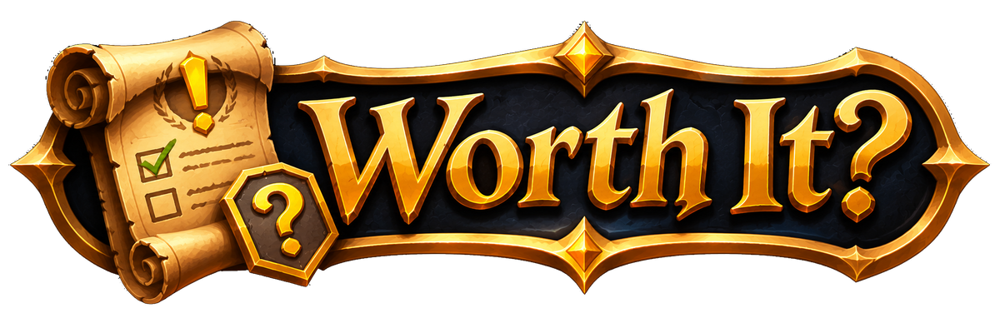
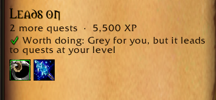
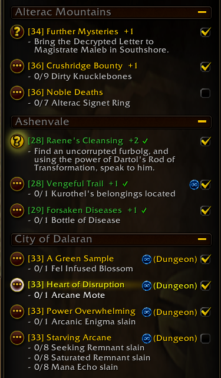

# Worth It

See where a quest leads in World of Warcraft: Forever, and whether it's
worth doing. Under a quest's rewards: how many quests follow it, and what
the rest of the chain gives.

Not released yet: this is work in progress.

**What's in it**

- **Leads on:** the quests still to come after this one, with their total
  XP and money. Point at it to see each step.
- **Reward items** from the rest of the chain, with their tooltips. Quests
  that let you choose show their choices after "One of".
- **Worth doing or safe to skip,** with the reason: a chain that opens a
  dungeon or raid, a class quest, a rare reward, a good share of a level,
  or a grey quest that leads back up to your level.
- **Marks** for class quests, attunements and dungeon keys, spells a quest
  teaches, and epic rewards.
- **"+4" in quest lists:** after each quest in the quest log and in a quest
  giver's list, and a small number on Questie's "!" icons on the map.
- **A window of quests worth a second look:** ones you dropped and can take
  again, ones below your level you never did that still lead somewhere,
  and chains worth seeking out. Click one to mark its giver on your map.

**Getting started**

Worth It needs Questie: it reads Questie's quest data for the chains.
There's nothing to set up. `/worth` or the minimap button
opens the window, and its Options button the options.

**Notes**

- XP is for your level now, before any bonus. At the level cap XP is paid
  as money, which is counted once you've handed in a quest there.
- Rewards come from the game. Some only show once you've opened the quest
  or it's in your log; Worth It remembers what it sees.
- Quests you dropped come from Questie's journey and from Worth It's own
  record. Quests dropped before you had either can't be known.
- Found a bug? Open an issue on
  [GitHub](https://github.com/flightpathlabs/Worth-It/issues).

Worth It is a fan-made addon, not affiliated with Blizzard
Entertainment. It reads Questie's quest database (QuestieDB) while the game
runs and copies none of Questie's code or data. Questie and QuestieDB are
made by the Questie team; thank you.

MIT licence, see [LICENSE](LICENSE). Changes are in the
[changelog](CHANGELOG.md). AI tooling is used openly in making this
addon; everything is reviewed and tested in game before release.

**More from Flight Path Labs**

Small addons for World of Warcraft: Forever, all at
[github.com/flightpathlabs](https://github.com/flightpathlabs).

- [Gold Wise](https://github.com/flightpathlabs/GoldWise): auction prices for what you carry, and what's worth doing with it.
- [Creel](https://github.com/flightpathlabs/Creel): a fishing log and one-key cast.
- [Temper](https://github.com/flightpathlabs/Temper): how your character fights, and whether a change helped. Coming soon.
- [Encore](https://github.com/flightpathlabs/Encore): helpers for enchanters. Coming soon.
